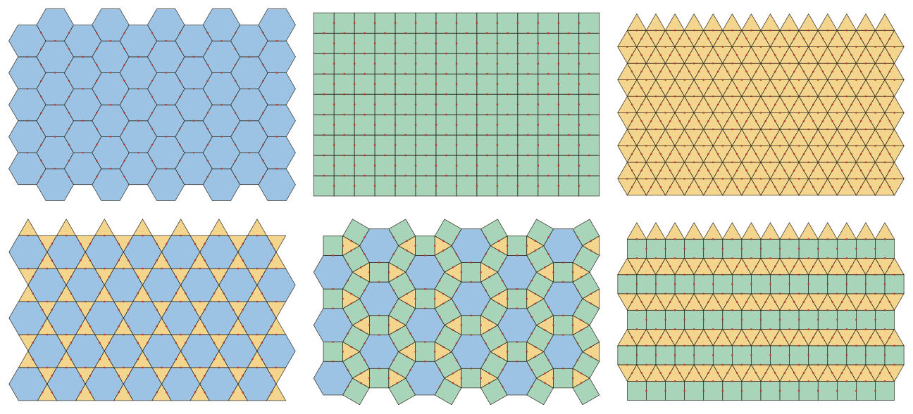

# maze-hex: plan

maze-hex is a sibling of [Lubra](https://github.com/daleobrien/lubra) and
[maze-rs](https://github.com/daleobrien/maze-rs). It makes hand-drawn track
mazes, like Lubra does, but on a grid of **hexagons**, or more generally on any
tiling of polygons with **at most six sides that all have the same length**.

The one rule that makes it different from Lubra:

> A track only ever joins a tile at the **middle of an edge**.

Lubra's tracks can leave a triangle at six node positions and pass over and
under each other. That needs hundreds of generated fragments, clearance tables,
a visible/hidden net split and a drawing order. With edge-middle connections
and no crossings, maze-hex needs none of it. Each tile's drawing depends only on
which of its edges are open and how they are grouped, and it never leaves the
tile.

---

## 1. Why "all edges the same length" matters

If every edge in the tiling has length `L`:

- **Every edge is the same port.** A track meets an edge at its middle, at a
  right angle, with the same width `W`. So any tile can join any other tile,
  whatever its shape: a hexagon can hand its track to a square or a triangle.
- **One track width works everywhere.** `W` is a fixed fraction of `L`
  (about 0.4; see §5.4), so mixed tilings look even.
- **Exact coordinates.** Triangles, squares and hexagons have interior angles
  of 60°, 90° and 120°. Walking round any tile only turns by multiples of 30°, so
  every edge is one of 12 unit vectors and every vertex is exactly
  `((a + b√3)/2, (c + d√3)/2)` for integers `a, b, c, d`. Neighbouring tiles
  agree *exactly* on shared vertices and edges, so a `HashMap` stitches the
  tiling together with no epsilon. This is built and tested already
  (`lib/src/geometry.rs`).

That last point covers more than regular polygons. **Any equilateral polygon
whose angles are multiples of 30° stays exact**: the 30° and 60° rhombus, the
"house" pentagon (a square with a triangle on top: angles 90, 90, 150, 60, 150),
and non-regular equilateral hexagons. "No more than six sides, all the same
length" fits this family exactly. Penrose rhombs (36°) and the Cairo pentagon do
not fit. They would need a second number system (√5) or floats with tolerant
hashing, so they are left as a stretch goal (§9).

## 2. Which tilings

All of these use only triangles (3), squares (4) and hexagons (6) with equal
edges. ✅ means it is in `lib/src/tiling/catalogue.rs` and passes the tests now.

| Tiling | Vertex config | Tiles | Status |
| ------ | ------------- | ----- | ------ |
| Hexagonal | 6.6.6 | hexagon | ✅ main target |
| Square | 4.4.4.4 | square | ✅ |
| Triangular | 3.3.3.3.3.3 | triangle | ✅ (Lubra's grid, but with edge-only tracks) |
| Trihexagonal | 3.6.3.6 | hexagon + triangle | ✅ |
| Rhombitrihexagonal | 3.4.6.4 | hexagon + square + triangle | ✅ |
| Elongated triangular | 3.3.3.4.4 | square + triangle | ✅ |
| Snub square | 3.3.4.3.4 | square + triangle | phase 3 |
| Snub hexagonal | 3.3.3.3.6 | hexagon + triangle (chiral) | phase 3 |
| 2-uniform tilings (the 20 using 3/4/6) | e.g. [3⁶; 3².4.3.4] | mixed | phase 8 |
| Square–triangle quasicrystal | 12-fold | square + triangle | phase 8 (inflation by 2+√3, still exact) |
| Rhombus / house-pentagon tilings | – | equilateral, 30° angles | phase 8 |



*`make tilings` draws these into `docs/tilings/`. The red dots are the ports:
the middles of edges a track may cross.*

## 3. Architecture

The layout copies Lubra (a Cargo workspace, Makefile-driven, commits to `main`),
but it is much smaller. Lubra's `generate` crate goes away because there are no
fragments to pre-render.

```
maze-hex/
├── lib/            the library (no file I/O, so it also builds for wasm)
│   └── src/
│       ├── geometry.rs        ✅ exact Q(√3) numbers, points, the 12 directions
│       ├── tiling/            ✅ faces, edges, vertices; unit cells; clipping
│       │   └── catalogue.rs   ✅ the unit cell of every tiling
│       ├── maze/              the spanning tree over tiles (or ports)
│       │   ├── mod.rs         Maze { tiling, open ports, blocks per tile, entrance, exit }
│       │   ├── algorithms.rs  Wilson, backtracker, Kruskal, Prim
│       │   ├── blocks.rs      non-crossing groupings of a tile's ports (phase 5)
│       │   └── solution.rs    the route from entrance to exit
│       ├── render/
│       │   ├── curves.rs      the centreline and wall curves between two ports
│       │   ├── walls.rs       walls per tile, then chained into long strokes
│       │   ├── svg.rs         plain SVG
│       │   ├── ink.rs         the hand-drawn pen (ported from Lubra)
│       │   └── png.rs         behind the `png` feature, like Lubra
│       └── debug_svg.rs       ✅ tiling preview (tiles shaded, ports dotted)
├── cli/            the `maze-hex` binary (clap), same flags as Lubra where they fit
├── document/       later: writes the figures for the Typst design notes
├── typst/          later: design notes, like Lubra's main.pdf
├── docs/           README images, drawing.md, settings.md
└── .github/workflows/ci.yml   ✅ fmt, clippy -D warnings, test
```

### 3.1 Data model (tiling, built)

```rust
struct Tiling { points: Vec<Point>, faces: Vec<Face>, edges: Vec<Edge> }
struct Face   { kind: PolygonKind, vertices: Vec<usize>, edges: Vec<usize> } // anticlockwise
struct Edge   { vertices: [usize; 2], faces: [Option<FaceSide>; 2] }        // 1 face = boundary
```

A tiling is a `UnitCell` (two lattice vectors and the tiles in one cell),
repeated over a rectangle. A tile is kept if its centre is inside the
rectangle. Then only the largest group of tiles joined edge to edge is kept,
so no tile is reachable only through a corner. Each prototile is just
`(shape, first vertex, direction of first edge)`. Its vertices come from walking
the edges and turning by the exterior angle, so a unit cell is a few lines of
data.

### 3.2 Data model (maze, to build)

```rust
struct Maze {
    tiling: Tiling,
    open: Vec<bool>,               // per edge: does a track cross it?
    blocks: Vec<Vec<Block>>,       // per face: groups of open sides joined inside the tile
    entrance: Port, exit: Port,    // a boundary edge each, or a marker tile
    seed: u64,
}
struct Block(Vec<usize>);          // side indices, in anticlockwise order
```

In **hub mode** (phases 2–4) every face has at most one block holding all its
open sides. In **pass-through mode** (phase 5) a face can hold several blocks
that don't cross.

## 4. Generating the maze

### 4.1 Hub mode: a tree over tiles (phase 2)

The dual graph has one node per tile and one link per interior edge. A
spanning tree of it is a perfect maze: one route between any two tiles. Each
algorithm gives a different feel, and `--algorithm` picks one:

| Algorithm | Feel |
| --------- | ---- |
| Wilson (default) | uniform spanning tree, unbiased, lots of short dead ends |
| Recursive backtracker | long winding corridors, few junctions |
| Randomised Kruskal / Prim | many short branches |
| Growing tree (mix of newest/random) | tunable between the two |

Each step in hub mode is ordinary, well-tested maze code that works on any
graph, so all tilings come for free once one does.

Style knobs (weights when picking the next link):

- `--straightness`: prefer going straight through a tile (opposite sides)
  over turning. On hexagons this decides between long straight runs and
  constant zig-zags.
- `--junctions`: penalise tiles that already have 3+ open sides.
- In mixed tilings, optionally prefer routes through big tiles (hexagons)
  over small ones (triangles).

**Entrance and exit.** These are bottom left and top right, as in Lubra. Pick
the boundary tile nearest each corner. Grow the tree over every other tile
first, then attach these two as leaves, so each is a dead end and can carry
Lubra's red marker disc. The `maze.do.id.au` site wants every maze to share this
look.

**Solution.** BFS on the tree from entrance to exit, kept as a list of
`(face, from side, to side)`.

**Dead-end trimming** (`--trim-dead-ends N`, like Lubra). Removing a dead end
in a perfect maze leaves its tile blank. Lubra accepts that, and maze-hex
can too. The default is `0` here because blank tiles in a hexagon grid stand
out more.

### 4.2 Pass-through mode: a tree over ports (phase 5)

This gives the Lubra look without the Lubra machinery. A tile may hold
**several separate tracks**, as long as they don't cross. In a hexagon with
sides 0–5, a track can turn from side 0 to side 1 while another runs from side 3
to side 4 in the same tile. Because the groups are **non-crossing**, nothing
passes over or under anything, and there is still no drawing order.

The model:

- The **nodes** are ports: interior edges, plus the entrance and exit boundary
  edges.
- The **links** are chords: a pair of sides `(i, j)` inside one tile (3 per
  triangle, 6 per square, 15 per hexagon).
- A tile's chords must be **non-crossing**. Chords `(a, b)` and `(c, d)` cross
  exactly when one of `c, d` lies strictly between `a` and `b` going round the
  tile and the other doesn't. Chords that share a side merge into one block,
  which is a junction.
- Each tile state must also pass the **clearance table** (§5.4).

The algorithm is randomised Kruskal over all chords. Accept a chord if its two
ports are in different trees (so no loop forms), it crosses nothing already in
its tile, and the tile still passes clearance. Then come the repair passes,
which are smaller cousins of Lubra's:

1. **Join**: if more than one tree remains, merge two blocks that are next
   to each other in some tile (that never creates a crossing), and repeat.
2. **Cap**: a port used on only one side ends in the other tile as a
   one-side block: a dead end with a rounded cap.
3. **Fill**: a tile with no block gets a short branch grown in from an
   open neighbour, if clearance allows. Otherwise it stays blank, as in Lubra.

The states are few. A hexagon's six sides can be grouped without crossings in
132 ways (a Catalan number). Allowing closed sides as well, a hexagon has 731
states, a square 51 and a triangle 15. That is small enough to list, test and
draw every one in the design notes.

## 5. Drawing

### 5.1 The centreline between two ports

A track leaves side `i` at its middle `Mᵢ`, at right angles to the edge. For
two sides of a **regular** polygon there are only three cases. Each is exact
and has a closed form:

| Sides | Curve | Centre | Radius (L = 1) |
| ----- | ----- | ------ | -------------- |
| Next to each other (share vertex V) | arc | V | 1/2 |
| Parallel (opposite, in squares and hexagons) | straight line | – | – |
| Otherwise (hexagon sides two apart) | arc | where the two edge lines meet | 3/2 |

For non-regular equilateral tiles (phase 8), those centres are no longer the
same distance from both midpoints. A cubic Bézier with end tangents at right
angles to the edges is the fallback.

### 5.2 Walls

A track is a band of width `W` around its centreline. Each port has two
**side points**, `Mᵢ ± (W/2)·edge direction`. The wall rule is one loop:

> For each block, list its sides in anticlockwise order. For each pair of
> consecutive sides `(p, q)`, wrapping round, draw a wall from `p`'s trailing
> side point to `q`'s leading side point. Use the same curve rule as the
> centreline, offset by `W/2` toward the closed edges between `p` and `q`.

That gives every shape with no special cases:

- **1 side**: a dead end. Its wall is a U-turn: straight in, then a semicircle
  cap of radius `W/2` near the tile centre. The entrance and exit add the red
  marker disc.
- **2 sides**: a bend or straight. Two walls: the inner and outer offsets of
  the centreline.
- **3+ sides**: a junction. The walls are the inner offsets between
  neighbouring sides. In a triangle with all three sides open, these are three
  arcs of radius `(1 − W)/2` round the corners, which looks right.

### 5.3 One continuous line

A side point on an open port has exactly two wall pieces, one from each tile.
So the wall pieces chain together across tiles. The outline of a tree-shaped
track is a **single closed curve**, so the whole maze's walls are one line. If
the entrance and exit are open to the outside, it is two lines.

This has three benefits:

- The ink pen draws long, smooth strokes that wander naturally, instead of
  thousands of stubs.
- The SVG is small: a few `<path>`s, not one per tile.
- **Pen-plotter output** comes almost free, with one pen-down for the whole
  maze.

The ink wobble must be the same from both sides of a shared point. So the
wobble is keyed by `(edge id, which side)` or by exact coordinates, never by
float position.

### 5.4 Clearance

Containment is the rule that makes drawing order irrelevant:

> **Every wall a tile draws stays inside that tile**, more than a margin `m`
> from any closed edge, except where it runs into an open port.

Then tiles never interfere, and within a tile only blocks have to be checked
against each other. The worst cases are in hexagons. The numbers below have
the tightest gap between two blocks, with `W = 0.45`:

| Hexagon state | Closest approach | Gap |
| ------------- | ---------------- | --- |
| `{0,2}` + `{3,5}` (two wide arcs) | 2√3 − (3 + W) | 0.014: too tight |
| `{0,3}` + `{1,2}` (straight + corner arc) | 1 − (1/2 + W) | 0.05 |
| `{0,1}` + `{3,4}` (two corner arcs) | far apart | fine |

So the track width decides which pass-through states are allowed. A test
samples every block's walls for every polygon and every state, and builds the
**allowed-state table** for a given `W` and `m`. It is cached at start-up,
because about 800 states is cheap, so nothing needs code generation. In
hub mode, `W ≤ ~0.6` keeps the outer corner arc (radius `1/2 + W/2`) clear of
the far edges in every shape (vertex to far edge ≥ √3/2).

### 5.5 Output and flags

The aim is to keep Lubra's command line wherever it makes sense:

```
maze-hex --tiling hexagonal --seed 1 -W 30 -H 20 -o maze
         [-S solution] [-P plain] [-F svg|png]
         [-B tile boundaries] [-N face numbers] [-T ports and blocks]
         [--algorithm wilson|backtracker|kruskal|prim|growing-tree]
         [--mode hub|pass-through] [--track-width 0.42]
         [--straightness 0.0..1.0] [--trim-dead-ends N] [--plotter]
```

`-W`/`-H` are in edge lengths, because "columns" has no meaning in a mixed
tiling. A hexagon is 2 wide and √3 tall. `--tiling list` prints the catalogue.

## 6. Phases

Each phase ends with `make lint` clean: no build warnings, `cargo fmt`, and
`clippy -D warnings`. Commits go to `main`.

| # | Phase | Delivers | Done when |
| - | ----- | -------- | --------- |
| 0 | Scaffold ✅ | workspace, Makefile, CI, README, this plan | `make lint test` passes |
| 1 | Geometry and tilings ✅ (mostly) | exact Q(√3), 6 unit cells, clipping, `make tilings` | tests below pass; **still to do:** boundary smoothing (drop spiky one-neighbour tiles) and region shapes (rectangle, hexagon, circle) |
| 2 | First hex maze | `maze/` hub mode with Wilson + backtracker, `render/curves.rs`, `walls.rs`, plain `svg.rs`, `cli` with `--seed -W -H -o -S -B -N` | `make maze` draws a hexagon maze and its solution, the same for the same seed |
| 3 | Every tiling | the same maze on all catalogue tilings, plus snub square and snub hexagonal | every tiling draws; tree and containment tests pass on all of them |
| 4 | Ink | port `ink.rs` from Lubra (pen wobble, width wander, red pencil solution), chained strokes, `-P` plain | ink mazes look like Lubra's; walls are one continuous line |
| 5 | Pass-through | `blocks.rs`, non-crossing Kruskal and repair passes, clearance table, `--mode` | a hexagon maze with two tracks in some tiles, no wall closer than `m` |
| 6 | Outputs and web | `png` feature, wasm build, `--plotter`; add `?maze=hex` to maze.do.id.au as a third wasm, next to the maze-rs and Lubra ones | playable at maze.do.id.au; S3 deploy via the existing GitHub Action |
| 7 | Documents | README in Lubra's style (cover image, Play link, quick start, documents table), `docs/drawing.md`, `docs/settings.md`, Typst design notes with every tiling, curve case and allowed state | `make doc` builds the PDFs |
| 8 | Stretch | 2-uniform tilings, the square–triangle quasicrystal (inflation), rhombus and house-pentagon tilings, Bézier fallback curves, shaped regions or image masks, Penrose and Cairo (needs Q(√5) or floats) | – |

## 7. Tests

These already pass, for every tiling in the catalogue:

- Each unit cell's tiles cover exactly its area, and every tile runs
  anticlockwise.
- Every edge is *exactly* one of the 12 unit vectors.
- Each edge borders at most two faces, and each face's edge list matches its
  sides.
- Every interior vertex is surrounded by exactly 360°. This catches overlaps
  and gaps.
- The clipped tiling is one piece.

Still to add, by phase:

- **Tree**: open links = tiles − 1, and every tile is reachable (hub mode). In
  pass-through mode the same check runs over ports and chords.
- **Determinism**: the same seed and flags give byte-identical SVG.
- **Non-crossing**: no tile holds two crossing chords (property test over many
  seeds).
- **Containment and clearance**: sampled wall points stay inside their tile, by
  margin `m`, away from open ports. Different blocks stay at least `m` apart.
- **Continuity**: chained walls make closed loops, one per tree component.
- **Solution**: it starts at the entrance, ends at the exit, and every step
  crosses an open edge.
- **Snapshots**: small SVGs for a few seeds, so changes show up in review.

## 8. Code quality

- Rust 2021 with no `unsafe`, and no `unwrap` in library code without a comment
  saying why it can't fail.
- `make lint` = `cargo fmt --all --check` + `cargo clippy --workspace
  --all-targets -- -D warnings`. CI runs it with `RUSTFLAGS=-D warnings`.
- `lib` does no I/O, so the same crate builds for the CLI, the PNG writer and
  wasm.
- Comments explain *why*, in plain sentences, like Lubra's.

## 9. Open questions

1. **"A series of polygons."** Does that mean the catalogue (one tiling per
   maze, chosen with `--tiling`) or several shapes mixed in *one* maze? The
   mixed Archimedean tilings already do the second. The square–triangle
   quasicrystal (phase 8) goes further: a non-repeating mix.
2. **Hub first or pass-through first?** Hub mode is the quickest way to a
   working hexagon maze. Pass-through is what makes it feel like Lubra. The
   plan does hub mode first.
3. **Where the repo lives.** The plan assumes `~/Code/maze-hex` and a public
   `daleobrien/maze-hex`, like Lubra and maze-rs.
4. **Sharing the ink pen.** Copy Lubra's `ink.rs` into maze-hex, or move it into
   a small shared crate that Lubra, maze-rs and maze-hex all use?
