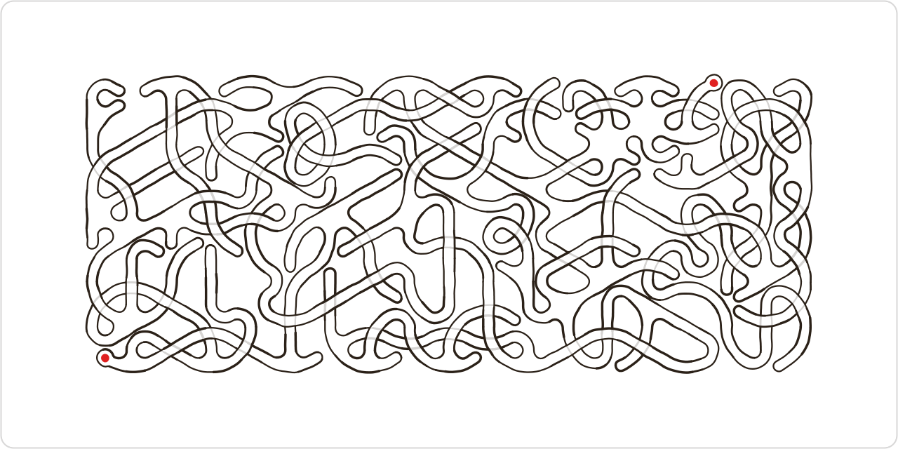

<h1 align="center">maze-hex</h1>

<p align="center">Hand-drawn track mazes on hexagons, and on any tiling of equal-edged triangles, squares and hexagons, in Rust.</p>

<p align="center">
  <a href="#quick-start"><b>Quick start</b></a> &nbsp;·&nbsp;
  <a href="#documents">Documents</a> &nbsp;·&nbsp;
  <a href="#how-it-works">How it works</a> &nbsp;·&nbsp;
  <a href="PLAN.md">Plan</a>
</p>

<p align="center">
  
</p>

maze-hex is a sibling of [Lubra](https://github.com/daleobrien/lubra). It also
makes winding tracks drawn in ink, but a track only ever joins a tile at the
middle of an edge, and every edge in a tiling is the same length, so a track
can pass from a hexagon to a square to a triangle at the same width. Tracks
can cross in tiles of four or more sides, as bridges, each drawn inside its
own tile. It draws on twelve tilings, from plain hexagons to random mixes of
all three shapes, and is coming to [maze.do.id.au](https://maze.do.id.au) as
its third kind of maze.

## Quick start

```bash
make build                              # build everything
make cli CLI_ARGS="--seed 1 -S -o maze" # a hexagon maze with its solution: cli/maze.svg
make random                             # a random mix of all three shapes: cli/random.svg
make test                               # run the tests
make lint                               # cargo fmt --check and clippy, warnings as errors
make                                    # every task
```

## Documents

| Document | What's in it |
| -------- | ------------ |
| [Drawing mazes](docs/usage.md) | The make tasks, every command-line option, and examples |
| [Tilings](docs/tilings.md) | The twelve tilings, the random mixes and `--mix` |
| [How it works](docs/how-it-works.md) | Exact geometry, tracks inside a tile, building the maze, bridges, and drawing the walls |
| [PLAN.md](PLAN.md) | The design in full, the phases and what is still to do |

## How it works

Every edge points in a multiple of 30°, so every corner can be stored exactly
and neighbouring tiles agree on the points they share. Inside a tile each
track is a straight line or an arc between the middles of two edges, and a
table says which groupings of a tile's edges can be drawn without the walls
crowding. The maze is a randomised spanning tree over those joins, so one
tile can carry two separate tracks, a junction, or a bridge where two cross.
The walls are then chained across tiles into one continuous line and drawn in
the same hand-drawn ink as Lubra. [How it works](docs/how-it-works.md) has the
details.

---

<p align="center"><sub>Part of <a href="https://daleobrien.github.io/#mazes">Mazes</a> &nbsp;·&nbsp; more at <a href="https://daleobrien.github.io">daleobrien.github.io</a></sub></p>
