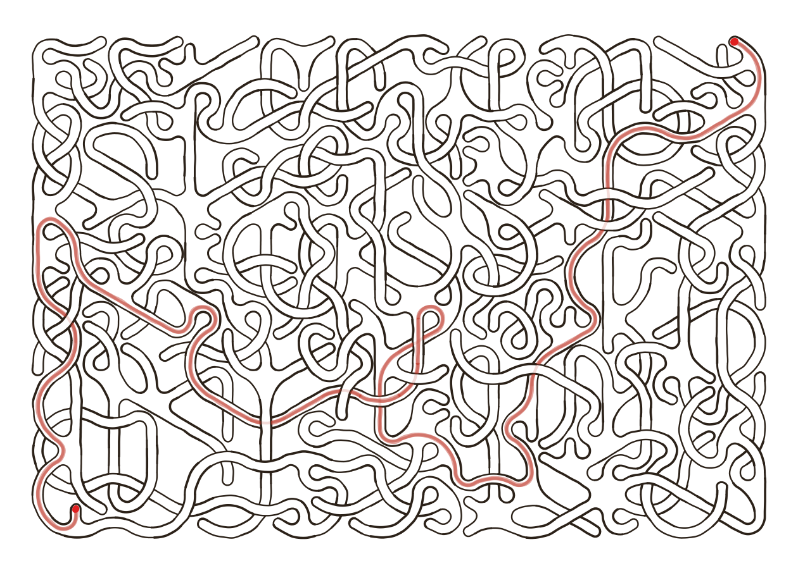
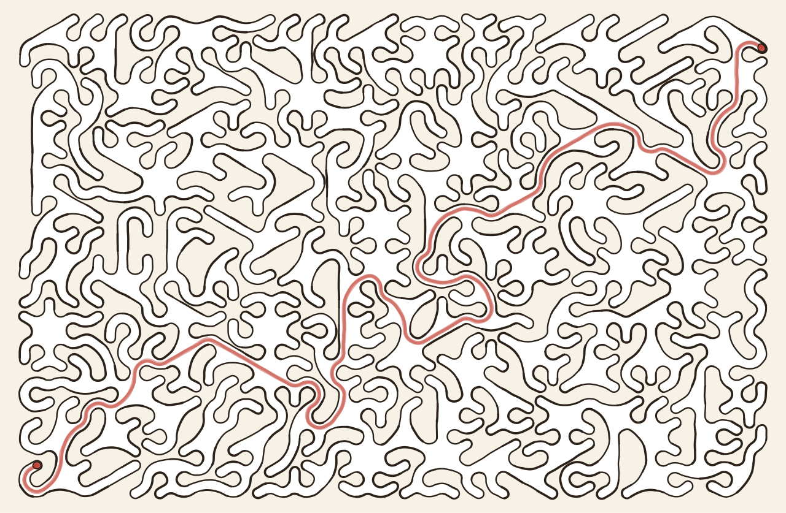

<h1 align="center">maze-hex</h1>

<p align="center">Hand-drawn track mazes on hexagons, and on any tiling of equal-edged triangles, squares and hexagons, in Rust.</p>

<p align="center">
  <a href="PLAN.md"><b>Plan</b></a> &nbsp;·&nbsp;
  <a href="#quick-start">Quick start</a> &nbsp;·&nbsp;
  <a href="#how-it-works">How it works</a>
</p>

<p align="center">
  
</p>

maze-hex is a sibling of [Lubra](https://github.com/daleobrien/lubra). It also
makes winding tracks drawn in ink, but tracks only ever join a tile at the
middle of an edge. No track passes over another, so there are no fragments to
generate and no drawing order to worry about. Every edge in a tiling has the
same length, so a track can pass from a hexagon to a square to a triangle with
the same width.

**Status:** phase 2 of [PLAN.md](PLAN.md). Mazes draw on nine tilings, including
a random mix of triangles and hexagons, with plain walls. Hand-drawn ink comes
next.

<p align="center">
  
</p>

## Quick start

```bash
make build     # build everything
make cli CLI_ARGS="--seed 1 -W 30 -H 20 -S -o maze"   # draw a maze: cli/maze.svg
make cli CLI_ARGS="--tiling list"                      # every tiling
make test      # run the tests
make lint      # cargo fmt --check and clippy, warnings as errors
make tilings   # draw every tiling into docs/tilings/
make           # list every task
```

## How it works

- `lib/src/geometry.rs`: exact coordinates. Every edge points in a multiple
  of 30°, so every vertex is `(a + b√3)/2` for integers `a`, `b`, and
  neighbouring tiles agree exactly on shared corners.
- `lib/src/tiling/`: tilings, either a unit cell repeated over a region
  (hexagonal, square, triangular, 3.6.3.6, 3.4.6.4, 3.3.3.4.4 and the two
  snubs) or a random mix (`triangle-hexagon`), clipped and smoothed.
- `lib/src/track/`: the track inside one tile. Every curve is a straight line
  or an arc round the point where two sides' lines meet. A table says which
  groupings of a tile's sides can be drawn without walls crowding.
- `lib/src/maze/`: randomised Kruskal over the tracks' joins, keeping every
  tile drawable, so a tile can carry two separate tracks without any crossing.
- `lib/src/render/`: walls chained across tiles into one continuous line,
  written as SVG.


---

<p align="center"><sub>Part of <a href="https://daleobrien.github.io/#mazes">Mazes</a> &nbsp;·&nbsp; more at <a href="https://daleobrien.github.io">daleobrien.github.io</a></sub></p>
