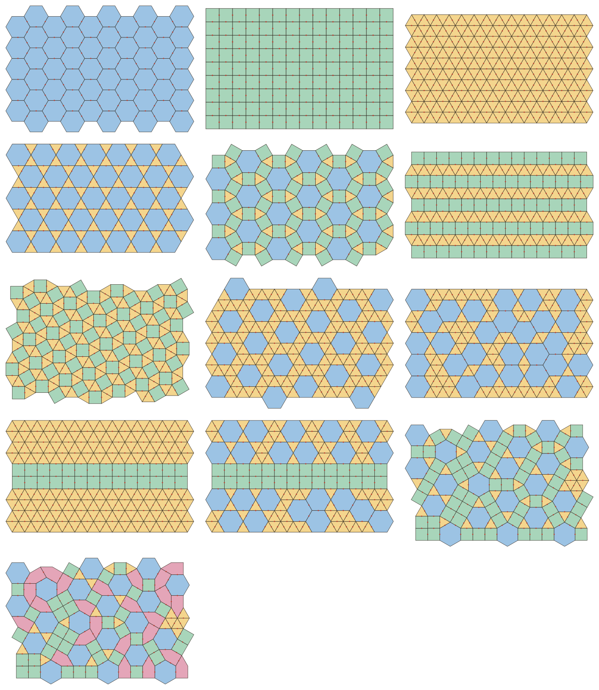
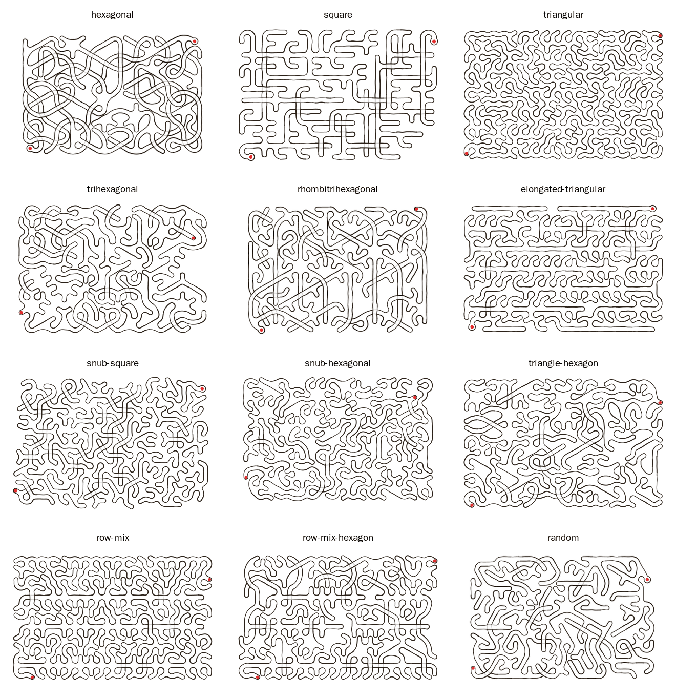

# maze-hex: design

[Back to the README](../README.md)

maze-hex is a sibling of [Lubra](https://github.com/daleobrien/lubra) and
[maze-rs](https://github.com/daleobrien/maze-rs). It makes hand-drawn track
mazes, like Lubra does, but on a grid of **hexagons**, or more generally on any
tiling of polygons with **at most six sides that all have the same length**.

The one rule that makes it different from Lubra:

> A track only ever joins a tile at the **middle of an edge**.

Lubra's tracks can leave a triangle at six node positions and pass over and
under each other. That needs hundreds of generated fragments, clearance tables,
a visible/hidden net split and a drawing order. With edge-middle connections,
maze-hex needs none of it. Each tile's drawing depends only on which of its
edges are open and how they are grouped, and it never leaves the tile.

Tracks may still cross, as **bridges** (§4.4): in a tile of four or more sides,
two through-tracks can cross, one passing over the other. Because the bridge
stays inside its tile, its over/under is decided and drawn there alone, so
there is still no drawing order across the maze.

This document is the design of the program as it is now: the reasoning, the
geometry and the numbers behind each rule, and the decisions (§9). The code
cites it by section number (for example "docs/design.md §5.4"), so those
numbers stay put. §6 lists how the program was built and what is still open.

---

## 1. Why "all edges the same length" matters

If every edge in the tiling has length `L`:

- **Every edge is the same port.** A track meets an edge at its middle, at a
  right angle, with the same width `W`. So any tile can join any other tile,
  whatever its shape: a hexagon can hand its track to a square or a triangle.
- **One track width works everywhere.** `W` is a fixed fraction of `L`
  (0.4 by default; see §5.4), so mixed tilings look even.
- **Exact coordinates.** Triangles, squares and hexagons have interior angles
  of 60°, 90° and 120°. Walking round any tile only turns by multiples of 30°, so
  every edge is one of 12 unit vectors and every vertex is exactly
  `((a + b√3)/2, (c + d√3)/2)` for integers `a, b, c, d`. Neighbouring tiles
  agree *exactly* on shared vertices and edges, so a `HashMap` stitches the
  tiling together with no epsilon (`lib/src/geometry.rs`: `Q3` is the number
  `(a + b√3)/2`, `Point` a pair of them, `Direction` one of the 12 unit
  vectors). Coordinates only become floats when a tile is drawn.

That last point covers more than regular polygons. **Any equilateral polygon
whose angles are multiples of 30° stays exact**: the 30° and 60° rhombus, the
"house" pentagon (a square with a triangle on top: angles 90, 90, 150, 60, 150),
and non-regular equilateral hexagons. "No more than six sides, all the same
length" fits this family exactly. Penrose rhombs (36°) and the regular pentagon
do not fit. They would need a second number system (√5) or floats with tolerant
hashing, so they are left open (§6, §9). The code today only builds regular
triangles, squares and hexagons; the rest of this family is room to grow, not
something that is drawn.

## 2. Which tilings

All of these use only triangles (3), squares (4) and hexagons (6) with equal
edges. `maze-hex --tiling list` prints the names, which are the same as in
`lib/src/tiling/catalogue.rs` (the periodic ones) and `lib/src/tiling/source.rs`
(the generators).

| Name | Vertex config | Shapes | Notes |
| ---- | ------------- | ------ | ----- |
| `hexagonal` | 6.6.6 | hexagons | The main target, and the default |
| `square` | 4.4.4.4 | squares | |
| `triangular` | 3.3.3.3.3.3 | triangles | Lubra's grid, but with edge-only tracks |
| `trihexagonal` | 3.6.3.6 | hexagons and triangles | |
| `rhombitrihexagonal` | 3.4.6.4 | hexagons, squares and triangles | |
| `elongated-triangular` | 3.3.3.4.4 | squares and triangles | |
| `snub-square` | 3.3.4.3.4 | squares and triangles | |
| `snub-hexagonal` | 3.3.3.3.6 | hexagons and triangles | Chiral; one of the two hands is built |
| `triangle-hexagon` | – | triangles and hexagons | Triangles merged into hexagons at random (`merge.rs`) |
| `row-mix` | – | squares and triangles | Random rows of each (`rows.rs`) |
| `row-mix-hexagon` | – | all three | `row-mix`, then hexagon merges |
| `random` | – | all three | Grown tile by tile with a chosen ratio, `--mix T,S,H` (`grow.rs`) |



*`make tilings` draws these into `docs/tilings/`. The red dots are the ports:
the middles of edges a track may cross.*



*`make gallery` draws one maze on each tiling, with the default settings.*

### 2.1 Mixing polygons in one maze

Mixed shapes in one maze are a first-class goal, so they shape the design from
the start. There are two kinds of mix:

- **Repeating mixes**: the mixed tilings in the table above (3.6.3.6, 3.4.6.4,
  3.3.3.4.4 and the snubs). A unit cell repeats, so they look orderly.
- **Free mixes**: triangles, squares and hexagons in a different arrangement
  every time, with a knob for how much of each. These need generators other
  than a unit cell.

**What this means for the design:**

- **Only `Tiling` crosses the boundary.** The maze and the drawing code see
  faces, edges and points, and nothing else: no `(i, j)` grid, no unit cell, no
  assumption that tiles repeat or that neighbours sit in fixed directions. Any
  generator that produces a `Tiling` gets mazes and drawings for free.
- **Generators sit behind one trait**, so the CLI can pick one by name:

  ```rust
  trait TilingSource {
      fn name(&self) -> &str;
      fn build(&self, region: Region, rng: &mut Rng) -> Tiling;
  }
  ```

  A periodic `UnitCell` is one implementation (it ignores `rng`) and each
  free-mix generator below is another. `source_names()` and `source_by_name()`
  in `source.rs` list and look them up. Every source goes through
  `Tiling::from_faces`, so the clipping, the boundary smoothing and the
  largest-piece step (§3.1) are shared by all of them.
- **Every rule works per tile shape.** The curves (§5.1), the wall rule (§5.2)
  and the clearance table (§5.4) are worked out for each of the three shapes
  separately. A track crossing from a hexagon into a triangle needs nothing
  special, because both sides of an edge are the same port.
- **Every maze test runs on a free mix too**, not only on the regular
  tilings, so nothing quietly assumes regularity (§7).

**The free-mix generators:**

1. **Merge** (`merge.rs`, the source `triangle-hexagon`). Start from the
   triangular tiling and, in random order, merge the six triangles round a
   vertex into one hexagon, so long as none of them is already merged. Each
   candidate vertex is taken with probability `hexagons` (0.6 by default). The
   result is a random triangle–hexagon mix, always valid and exact, because
   every hexagon is made of real triangles. `merge_hexagons` works on any
   tiling, so the same step also runs on the row mixes.
2. **Rows** (`rows.rs`, the sources `row-mix` and `row-mix-hexagon`). Each
   horizontal row is a strip of unit squares with probability 0.35, otherwise a
   strip of alternating up and down triangles. Rows must meet corner to
   corner, or an edge would end in the middle of another and the angles there
   would not add up to 360°. A square row keeps the horizontal position of the
   row below; a triangle row sits half a unit over, because its apexes land
   between its base corners. The only freedom left is which kind each row is,
   and where the first row starts. `row-mix-hexagon` then runs the merge step
   (0.6), which turns triangle rows into hexagons where six triangles meet, so
   all three shapes appear. The pattern is stripes, not a quasicrystal (see
   §6, Future work, for the square–triangle tiling this stands in for).
3. **Grow** (`grow.rs`, the source `random`, `--mix T,S,H`). Tiles are placed
   one at a time on the frontier of a patch that grows out from the middle,
   past the region's edge (by two edge lengths, so every tile whose centre is
   inside has all its corners closed), and is then clipped.
   - *Exact angles.* A vertex is an exact `Point`, and the angle already
     filled round it is a mask of twelve 30° sectors, so a gap is a run of
     empty sectors and there is no float angle to compare. Only the overlap
     test (a separating-axis test with a tolerance of 1e-9) uses floats.
   - *Valid corners.* The next tile goes into the smallest gap at the open
     vertex that is most filled (then the one nearest the middle, then the
     oldest, so the order never depends on a hash). A tile fits if it overlaps
     nothing and no vertex is left with a gap that no allowed shape can fill:
     a gap of one sector (30°) never can, and a gap of two sectors (60°) needs
     a triangle, three (90°) a square, four (120°) a hexagon or a triangle
     pair. This is the same as keeping every vertex completable to 360° from
     the valid corner types (3⁶, 3⁴.6, 3³.4², 3².4.3.4, 3.4.6.4, 3.6.3.6,
     3².6², 3.4².6, 4⁴, 6³). When no shape fits a corner, an earlier choice
     was wrong, so the grower removes the last few tiles (more the longer it
     keeps failing, at most 40) and tries again. Backing up is rare: the tests
     require fewer than one in ten steps.
   - *Weights.* `--mix T,S,H` gives three weights for triangles, squares and
     hexagons, `1,1,1` by default. A weight of 0 leaves that shape out. Each
     gap tries the shapes in an order drawn in proportion to their weights.
   - *Ratio steering.* Many gaps allow only one shape, so triangles and
     squares fill the forced gaps while hexagons, which need a wide gap, would
     be starved and the result would sit far from the ratio asked for. The
     weights are therefore multiplied by `exp(12 · (wanted share − actual
     share))`: a shape below its share is tried first more often, one above it
     less often.
   - *Not rows or lattices.* A square or hexagon that would share an edge with
     its own kind is a last resort, because rows of squares and lattices of
     hexagons are what an unguided growth settles into.
   - *A pull, not a promise.* The shares are a pull toward the ratio, not an
     exact ratio. In particular **`[0,1,1]` cannot mix**: a square and a
     hexagon at one vertex leave 360° − 90° − 120° = 150°, which no regular
     polygon fills, so without triangles squares and hexagons can never touch.
     A patch grown from edge to edge is then one shape all through, whichever
     it started with (the tests see all squares or all hexagons), and
     `--mix 0,1,1` gives a plain square or hexagonal maze. Triangles are what
     lets the other two shapes meet, so a mix with squares and hexagons needs a
     triangle weight above 0. Likewise `[1,0,0]` is the triangular tiling, and
     `[0,1,0]` the square one.

All three stay inside the 30° family, so coordinates stay exact and tiles still
join by `HashMap`.

## 3. Architecture

The layout copies Lubra (a Cargo workspace, Makefile-driven, commits to `main`),
but it is much smaller. Lubra's `generate` crate does not exist here because
there are no fragments to pre-render. The workspace has two packages: `lib`
(the package `maze-hex`, crate `maze_hex`) and `cli` (the binary `maze-hex`).
Neither has any dependency from crates.io: the command line is parsed by hand
and the random-number generator is in the crate, so the build works offline.

```
maze-hex/
├── Cargo.toml, Cargo.lock       the workspace (lib, cli); release profile strips symbols
├── Makefile                     build, test, lint, fmt, cli, random, maze, tilings, sample, cover, gallery (§5.5)
├── README.md                    cover image, quick start, documents table
├── .claude/CLAUDE.md            rules for AI assistants working on the repo
├── .github/workflows/ci.yml     CI: cargo fmt --check, clippy -D warnings, test, with RUSTFLAGS=-D warnings
├── lib/                         the library `maze-hex` (no file I/O, so it also builds for wasm)
│   ├── src/
│   │   ├── lib.rs               the module list
│   │   ├── geometry.rs          exact Q(√3) numbers (Q3), Point, the 12 Directions
│   │   ├── rng.rs               a seeded xoshiro256** (SplitMix64 seeding), pinned so a seed means the same maze everywhere
│   │   ├── tiling/              faces, edges, vertices; where tilings come from
│   │   │   ├── mod.rs           Tiling, Face, Edge, UnitCell, Prototile, PolygonKind; build, clip, smooth, largest piece, stitching by exact points
│   │   │   ├── region.rs        Region (width, height, smoothing) and Shape (rectangle, hexagon, circle)
│   │   │   ├── catalogue.rs     the unit cell of each of the eight periodic tilings
│   │   │   ├── source.rs        the TilingSource trait, source_names(), source_by_name() (§2.1)
│   │   │   ├── merge.rs         triangles to hexagons: `triangle-hexagon`, and the merge step the row mixes reuse
│   │   │   ├── rows.rs          random rows of squares and triangles: `row-mix`, `row-mix-hexagon`
│   │   │   ├── grow.rs          the grown free mix with a chosen ratio: `random`
│   │   │   └── checks.rs        assert_valid: the invariants every tiling must meet (tests only)
│   │   ├── track/               a track inside one tile
│   │   │   ├── mod.rs           TrackStyle: width, gap, margin, cap depth, rings
│   │   │   ├── curve.rs         V2, and Curve: line, arc, cubic Bézier; sampling and distances
│   │   │   ├── face.rs          FaceGeometry: a tile's centrelines, walls, side points, caps and rings (§5.1, §5.2, §5.6)
│   │   │   └── clearance.rs     which tile states draw cleanly, cached; bridge detection (§5.4, §4.4)
│   │   ├── maze/                the tree over ports (pass-through) or tiles (hub)
│   │   │   ├── mod.rs           Maze, Bridge, Cap, MazeOptions; entrance and exit choice (§3.2, §4.3)
│   │   │   ├── generate.rs      the pass-through generator: bridges first, Kruskal sweeps, repair (§4.1, §4.4)
│   │   │   ├── hub.rs           hub mode: Wilson, backtracker, Kruskal, Prim over tiles (§4.2)
│   │   │   └── solution.rs      the route from entrance to exit, and the one-tree check
│   │   ├── render/              drawing a maze
│   │   │   ├── mod.rs           the module list
│   │   │   ├── walls.rs         walls chained across tiles into long strokes; the bridges' upper tracks (§5.3)
│   │   │   ├── ink.rs           the hand-drawn pen, copied from Lubra and adapted (§5.3, §5.7)
│   │   │   └── svg.rs           SVG output: render(), SvgOptions, and Drawing for pages that draw on top (§3.3, §5.7)
│   │   ├── play.rs              Game: the interface the maze website drives (§3.3)
│   │   └── debug_svg.rs         a tiling preview: tiles shaded by shape, ports dotted
│   └── examples/
│       ├── tilings.rs           draws every tiling source (`make tilings`)
│       ├── sample.rs            draws one maze per tiling, for checking by eye
│       └── play.rs              walks part way along a solution and draws the Game overlay
├── cli/                         the `maze-hex` binary
│   └── src/
│       ├── main.rs              builds the tiling, grows the maze, writes the SVG; exit 2 for bad flags, 1 if no maze fits
│       └── args.rs              the hand-written flag parser and the help text (§5.5)
└── docs/
    ├── usage.md                 the make tasks, every option, examples
    ├── tilings.md               the twelve tilings, the random mixes and --mix
    ├── how-it-works.md          a short tour of the method
    ├── design.md                this document
    ├── cover.png, tilings.png, mazes.png      images the README and documents show
    ├── tilings/                 one preview SVG per tiling (`make tilings`)
    └── sample*.svg              sample mazes (`make sample`)
```

### 3.1 Data model (tiling)

```rust
struct Tiling { points: Vec<Point>, faces: Vec<Face>, edges: Vec<Edge> }
struct Face   { kind: PolygonKind, vertices: Vec<usize>, edges: Vec<usize> } // anticlockwise
struct Edge   { vertices: [usize; 2], faces: [Option<FaceSide>; 2] }        // 1 face = boundary
struct FaceSide { face: usize, side: usize }
```

Side `i` of a face runs from `vertices[i]` to `vertices[i + 1]`. An edge with a
tile on both sides is *interior* and can hold a port; `Edge::across(face)`
gives the tile on the other side and which of its sides this is.

A periodic tiling is a `UnitCell` (two lattice vectors and the tiles in one
cell), repeated over a region. Each prototile is just `(shape, first vertex,
direction of first edge)`. Its vertices come from walking the edges and
turning by the exterior angle, so a unit cell is a few lines of data. Every
generator, periodic or free, ends in `Tiling::from_faces`, which:

1. keeps a tile if its centre is inside the region (the rectangle, or the
   largest hexagon or circle in the box, with a tolerance of 1e-9 because the
   centres of symmetric tilings often sit exactly on a curved outline);
2. joins the tiles by exact vertex position, sharing points and edges;
3. unless smoothing is off, drops tiles that hang on by one edge or fewer,
   repeatedly (clipping leaves such spiky tiles on the edge of tilings like
   3.4.6.4; a track could only ever enter one and stop, and they make the
   outline look ragged);
4. keeps only the largest group of tiles joined edge to edge, so no tile is
   reachable only through a corner.

### 3.2 Data model (maze)

```rust
struct Maze {
    tiling: Tiling,
    blocks: Vec<Vec<Vec<usize>>>,  // per face: its blocks; each lists its sides anticlockwise
    bridges: Vec<Option<Bridge>>,  // per face: the crossing in it, if two tracks cross
    open: Vec<bool>,               // per edge: does a track cross it?
    entrance: Cap, exit: Cap,      // a dead end each: a tile and the side it is entered by
    ringed: [bool; 2],             // whether the entrance / exit has room for a ring (§5.6)
    style: TrackStyle,             // width, gap, margin, cap depth, ring size
    seed: u64,                     // the maze grew from it, and the ink pen is seeded with it too
}
struct Bridge { over: usize, under: usize }   // indices into that tile's blocks
struct Cap { face: usize, side: usize }
```

A **block** is a group of one tile's open sides that are joined inside the
tile. A block of one side is a dead end, two is a bend or a straight, three or
more is a junction. In **pass-through mode** (the default) a face can hold
several blocks, which don't cross, except for the one pair that forms a
bridge. **Hub mode** (`--mode hub`) is the special case where every face has at
most one block holding all its open sides. Together the blocks form a single
tree, so there is one route between any two places (`is_one_tree()` checks
this).

`Maze::generate(tiling, &MazeOptions)` builds a maze; `MazeOptions` holds the
`seed`, the `TrackStyle` and the `GenerateOptions` (mode, algorithm, and the
`--pass-through`, `--crossings`, `--junctions` and `--straightness` knobs of
§4.3). It returns `None` when the tiling is too small to hold a track with two
ends. The generator draws from its own random stream (the seed xor a constant),
and the choice of which track goes over each bridge from another, so changing
one thing never reshuffles another.

`TrackStyle` is in edge lengths: `width` 0.4, `gap` 0.1 (the least distance
between two walls), `margin` 0.06 (the least distance from a wall to a side it
doesn't cross), `cap_depth` 0.3, and the ring sizes (§5.6).

### 3.3 The play module and the maze website

`maze.do.id.au` shows Lubra, maze-rs and maze-hex mazes side by side, and every
engine has to look and behave alike. `lib/src/play.rs` is maze-hex's side of
that: it is the logic of Lubra's `Play` and its wasm `Game`, ported from nodes
and nets to maze-hex's tiles, sides and blocks, so the site can drive both
engines through one interface. Nothing in it knows about the browser, so it is
tested natively; the site's own `hex/` crate wraps it as `hex_web.wasm`.

`Game` is a maze and the player's trail through it:

- `Game::from_id(id, tiling, width, height, crossings)` makes a maze from the
  site's maze id. Any text is the seed, by its 32-bit FNV-1a hash (as the other
  engine takes it), so one id means one seed everywhere. An unknown tiling
  name falls back to `hexagonal`, a size below 4×4 is raised to 4×4, and if a
  maze will not fit the size grows a little until one does, so it never fails.
- The player always stands where a decision is needed: at the entrance, where
  a track opens into a junction (a block of three or more sides), or at a
  dead end (a block of one side). A move picks one of the ways on, the other
  sides of the player's block, and follows it through any plain stretch of
  track (blocks of exactly two sides, which includes both tracks of a bridge)
  to the next such place. Picking the way just come by goes back to the last
  junction instead.
- Moves come in four forms: `step(dx, dy)` and `toward(x, y)` take a direction
  or a point; `arrow(k)` takes an arrow key, where each way on gets its own key
  where there are keys enough (found by searching every assignment for the one
  that gives the most ways on a key, then the best-matching directions), so two
  ways in much the same direction can both be taken; and `cycle()` then
  `choose()` pick a way clockwise from up and take it, the overlay showing the
  track it would follow.
- `moves()` writes the trail as the side left by at the entrance and at each
  junction, one digit each (the stretches between follow on by themselves), and
  `replay()` walks such a string, stopping at the first move that does not fit,
  so a link can be shared. `restart()`, `solved()`, `trail_length()` and
  `position()` round it out.
- `maze_svg()` is the maze in ink, without its solution, with an empty
  `<g id='overlay'>` as the last child of the flipped group. `overlay(show_solution)`
  is markup for that group: the solution, the way chosen with `cycle` (light
  blue `#8db8e8`), the player's trail (blue `#1d5fa6`) and a dot where the
  player stands.

**Drawing units.** Every point and direction given to or returned from a
`Game` is in the drawing units of the SVG it draws, so a page can pass pointer
positions straight in: pixels, 40 per edge length, padding of 20, `y` pointing
up inside the flipped group (`Drawing` in `render/svg.rs` converts maze
coordinates to them with `Drawing::point`). The player's dot has radius 5.5
units, in a track about 16 wide, and the way back counts as a point 10 units
outside the opening the player stands at. `Drawing::pencil` pencils any route
with the maze's own pen, so a trail looks like the solution does: twice over,
faint where it passes under a bridge and on top of the bridge where it goes
over (§5.7).

### 3.4 The package name

The library package is `maze-hex` (crate `maze_hex`), not `lib`. Lubra's
library package is also called `lib`, and maze-website depends on both by path;
Cargo cannot write two path packages of the same name and version to one
lockfile. The directory is still `lib/`.

## 4. Generating the maze

### 4.1 Pass-through mode: a tree over ports (the default)

This gives the Lubra look without the Lubra machinery. A tile may hold
**several separate tracks**, as long as they don't cross (apart from a bridge,
§4.4). In a hexagon with sides 0–5, a track can turn from side 0 to side 1
while another runs from side 3 to side 4 in the same tile. Because the groups
are **non-crossing**, nothing passes over or under anything, and there is
still no drawing order.

The model:

- The **nodes** are ports: interior edges.
- The **links** are chords: a pair of sides `(i, j)` inside one tile (3 per
  triangle, 6 per square, 15 per hexagon).
- A tile's chords must be **non-crossing**. Chords `(a, b)` and `(c, d)` cross
  exactly when one of `c, d` lies strictly between `a` and `b` going round the
  tile and the other doesn't. Chords that share a side merge into one block,
  which is a junction.
- Each tile state must also pass the **clearance table** (§5.4).

None of this depends on the tile's shape beyond its number of sides, so mixed
tilings need nothing extra.

The algorithm is randomised Kruskal over all chords (`generate.rs`):

1. **Order.** Every chord gets a random key `u^(1/w)` and the chords are sorted
   largest first, which is a weighted shuffle. The weight `w` is
   `1 + 4·straightness` for a chord between opposite sides and 1 otherwise.
2. **Bridges first.** If crossings are on, each tile of four or more sides
   may get a bridge before anything else (§4.4).
3. **Sweeps.** The chords are then offered in five sweeps. A chord is accepted
   if its two ports are in different trees (so no loop forms) and:
   - if it would start a second, separate track in a tile that already has
     one, a coin with probability `--pass-through` (0.7) allows it;
   - if it makes a crossing, `--crossings` allows it (as a coin, and only when
     that is above 0);
   - in the first two sweeps, if it makes a junction of `n` sides (a block of
     three or more), it is kept with probability `junctions^(n−2)` (§4.3);
   - the tile still passes clearance (§5.4);
   - in the first two sweeps, every neighbour that would gain a dead-end cap
     because a port has just opened can still draw it.

   The first two sweeps therefore keep every tile drawable as they go, which
   suits hexagons. In triangles and squares that alone deadlocks: two
   neighbouring tracks can never meet, because opening the edge between them
   first gives one of them a dead end it has no room for. So the last three
   sweeps skip the neighbour check (and the junction coin), and the repair
   pass below sorts out any tile left crowded. Dead ends are short stubs
   (`cap_depth`, 0.3) so they leave room for other tracks in the tile.
4. **Repair.** For every tile that does not draw cleanly, each of its dead
   ends (a port open on this side with no chord in the tile) is first offered
   to the tile's existing tracks: if one of them is in a different tree,
   joining the dead end into it links the two trees, and that never creates a
   crossing. Any dead end that can't be joined is cut back: the neighbour's
   track stops short of the edge instead (and a track of one side left behind
   becomes a dead end or closes). Cutting a dead end never splits a tree. This
   repeats until every tile draws.
5. **Largest tree.** Every tree but the largest is cleared, so the maze is one
   piece. A tile whose tracks were all cleared is left blank (`blank_tiles()`;
   the CLI prints how many), which Lubra accepts too. The tests expect few.

So the repair pass does the work that Lubra's join, cap and fill passes do,
with a smaller set of moves, and there is no separate "fill" pass for a tile
with no block.

The states are few. A hexagon's six sides can be grouped without crossings in
132 ways (a Catalan number). Allowing closed sides as well, a hexagon has 731
states, a square 51 and a triangle 15. That is small enough to list, test and
draw every one. At the default width, 408 of the hexagon states are allowed,
16 of the square's and 8 of the triangle's; with bridges, 39 more hexagon
states, 1 square state and no triangle state (§4.4, §5.4).

### 4.2 Hub mode: a tree over tiles (`--mode hub`)

With at most one block per tile, the maze is a spanning tree of the dual graph:
one node per tile, one link per interior edge (`hub.rs`). Any classic
algorithm works on any tiling, mixed or not, chosen by `--algorithm`:

| Algorithm | Feel |
| --------- | ---- |
| `wilson` (the default) | uniform spanning tree, unbiased, lots of short dead ends |
| `backtracker` | long winding corridors, few junctions |
| `kruskal` / `prim` | many short branches |

Hub mode is the baseline: every single-block tile is drawable at any width
that fits the shape, so it needs no clearance table, and a spanning tree
visits every tile, so no tile is left blank. At `W` up to about 0.6, the outer
corner arc of a block (radius `1/2 + W/2`) stays clear of the far edges in
every shape (vertex to far edge ≥ √3/2); a test draws every single-block
state of every shape at the default width, and with rings. Bridges and
`--pass-through` do not apply in hub mode, and `--algorithm` is for hub mode
only. A growing-tree algorithm (a mix of newest and random, tunable between
backtracker and Prim) is left open (§6).

### 4.3 Shared by both modes

**Style knobs** (weights when picking the next chord or link):

- `--straightness` (0.3): prefer going straight through a tile (opposite
  sides) over turning, by the chord weight in §4.1. On hexagons this decides
  between long straight runs and constant zig-zags.
- `--junctions` (0.1): the first two sweeps keep a chord that makes a junction
  of `n` sides with probability `junctions^(n−2)`, so a three-way junction
  survives one time in ten and a four-way one in a hundred. Tracks then pass
  through or cross instead of branching. The later sweeps take any chord they
  need to finish the tree. At 1 the knob draws no random numbers, which
  repeats the mazes made before it existed.
- `--pass-through` (0.7): how often a tile that already holds a track takes a
  second, separate one.
- `--crossings` (0.8): see §4.4.

**Entrance and exit.** They are bottom left and top right, as in Lubra, and are
dead ends: after the maze is grown, the dead end whose cap centre is nearest the
bottom-left corner of the tiling's bounding box becomes the entrance, and the
nearest to the top-right corner (other than the entrance) the exit. This works
on ragged free-mix edges too. Each opens into Lubra's ring with a red dot
where a ring fits (§5.6). The maze site wants every maze to share this look.

**Solution.** BFS from entrance to exit over a graph of ports and blocks, kept
as a list of `Step { face, from side, to side }`; the first step has no `from`
and the last no `to`.

### 4.4 Bridges (`--crossings`)

Tiles of four or more sides may hold one crossing, drawn as a bridge.

- **What may cross.** Exactly two blocks of two sides each (through-tracks, no
  junctions), and only one crossing per tile. Any other blocks in the tile must
  not cross anything. Triangles have too few sides to cross.
- **Clearance.** The two tracks' walls may cross each other; every other check
  in §5.4 still applies. The centrelines must cross at 40° or more and at
  least one track width inside the tile, so it reads as one track passing over
  the other. At width 0.4 a square has one bridge state (the straight cross) and
  a hexagon 39.
- **Generation.** Before the sweeps, each tile of four or more sides gets a
  bridge with probability `--crossings` (default 0.8): all the sets of four
  interior sides `a < b < c < d` are listed (chords `(a, c)` and `(b, d)`),
  shuffled, and the first that draws cleanly and whose ends are in different
  trees is used. Bridges must come first: once the sweeps have joined a tile's
  ports into one tree, a crossing track would close a loop, and the tile is
  usually crowded with dead ends by then anyway. Laid first, each bridge just
  joins four separate ports into two pairs, and the sweeps grow the rest of the
  maze round them. Setting `--crossings 0` repeats the mazes made before
  bridges existed, exactly, and a test pins that.
- **Limit.** Where a hexagon's neighbours are all triangles (3.6.3.6), the
  bridge's ends can't fit beside the triangles' own tracks and are cut back
  by the repair pass, so that tiling rarely keeps a bridge. The repair pass
  does not protect bridges in general, which is what holds hexagon mazes to
  under half bridges (§6, Future work).
- **Over or under.** A coin per bridge, from its own random stream, so it
  doesn't disturb the maze. `Maze::bridges` records which block goes over.
- **Drawing.** The walls go first (without the upper tracks'). Then each
  bridge paints its upper band in the track colour, covering the lower track,
  draws the lower track's walls faintly (opacity 0.2) clipped to the band, so a
  hidden track can still be followed underneath, and then draws its own two
  walls. The route is drawn once, on top, with an SVG mask
  cutting it out of the bands of the bridges it passes under (drawing it twice
  would leave darker blotches where semi-transparent strokes overlap). Where it
  passes under, it shows as a faint trace across the bridge, as in Lubra (§5.7).

**Defaults.** `--junctions` keeps a junction of `n` sides early on with
probability `junctions^(n−2)`, which favours bridges over hubs. The defaults
were raised twice, to `--crossings 0.8 --junctions 0.1`. On 30×20 hexagons,
bridges went from 14% of tiles (0.3 and 1) to 33% (0.5 and 0.3) to 46%,
junction tiles from 58% to 40% to 25%, and dead ends per 100 tiles from 117 to
62 to 41. The random mix stays near 12% bridges, because triangles can't hold
one and squares only fit the straight cross.

## 5. Drawing

### 5.1 The centreline between two ports

A track leaves side `i` at its middle `Mᵢ`, at right angles to the edge. For
two sides of a **regular** polygon there are only three cases. Each is exact
and has a closed form:

| Sides | Curve | Centre | Radius (L = 1) |
| ----- | ----- | ------ | -------------- |
| Next to each other (share vertex V) | arc | V | 1/2 |
| Parallel (opposite, in squares and hexagons) | straight line | – | – |
| Otherwise (hexagon sides two apart) | arc | where the two edge lines meet | 3/2 |

`FaceGeometry::between` (`track/face.rs`) has one rule for all three: if the
sides are parallel and the two points face each other, a straight line;
otherwise an arc round the point where the two sides' lines meet, which in a
regular polygon is the same distance from both points, so the arc meets both
sides squarely. For a tile where those distances differ (an irregular
equilateral tile, not built), a cubic Bézier with end tangents at right angles
to the edges is the fallback; `Curve::Cubic` exists for it, and no regular tile
uses it.

### 5.2 Walls

A track is a band of width `W` around its centreline. Each port has two
**side points**, `Mᵢ ± (W/2)·edge direction`. The wall rule is one loop:

> For each block, list its sides in anticlockwise order. For each pair of
> consecutive sides `(p, q)`, wrapping round, draw a wall from `p`'s trailing
> side point to `q`'s leading side point. Use the same curve rule as the
> centreline, offset by `W/2` toward the closed edges between `p` and `q`.

That gives every shape with no special cases:

- **1 side**: a dead end. Its wall is a U-turn: straight in, then a semicircle
  cap of radius `W/2`, its centre `cap_depth` (0.3) into the tile and never past
  the tile's centre. The entrance and exit add the red marker (§5.6, §5.7).
- **2 sides**: a bend or straight. Two walls: the inner and outer offsets of
  the centreline.
- **3+ sides**: a junction. The walls are the inner offsets between
  neighbouring sides. In a triangle with all three sides open, these are three
  arcs of radius `(1 − W)/2` round the corners, which looks right.

### 5.3 One continuous line

A side point on an open port has exactly two wall pieces, one from each tile.
So the wall pieces chain together across tiles (`render/walls.rs`), joined by
a key of (edge, which end of it the point is nearer), the same from both
tiles, which floats could not give. The outline of a tree-shaped track is a
**single closed curve**, so the whole maze's walls are one line. The entrance
and exit are dead ends, not holes in the border, so this holds for them too; a
test checks one closed stroke on every tiling. (With bridges, the upper
track's walls are left out of the chain and drawn last by each bridge, so the
walls then end where a bridge begins.)

This has three benefits:

- The ink pen draws long, smooth strokes that wander naturally, instead of
  thousands of stubs.
- The SVG is small: a few `<path>`s, not one per tile.
- **Pen-plotter output** would come almost free, with one pen-down for the
  whole maze (not built; §6).

The ink wobble must be the same from both sides of a shared point. So the
wobble depends only on where a point is on the page (smooth value noise, from
the maze's seed), never on which tile it was computed from. The pen (`ink.rs`)
is Lubra's: it nudges points by up to 1.1 pixels with a feature size of 16,
changes the line width among 0.8, 1.0 and 1.22 times 3 pixels every five
pieces without lifting, and flattens curves into pieces no longer than 3
pixels. Lubra's sizes are scaled down because a maze-hex edge is 40 pixels
where a Lubra tile is 120. The same wobble draws the paper-coloured fill of the
track, so no paper shows outside the ink.

### 5.4 Clearance

Containment is the rule that makes drawing order irrelevant:

> **Every wall a tile draws stays inside that tile**, more than a margin `m`
> (0.06) from any closed edge, except where it runs into an open port.

Then tiles never interfere, and within a tile only blocks have to be checked
against each other: walls must be at least `gap` (0.1) apart. The worst cases
are in hexagons. The numbers below have the tightest gap between two blocks, at
the default `W = 0.4`:

| Hexagon state | Closest approach | Gap |
| ------------- | ---------------- | --- |
| `{0,2}` + `{3,5}` (two wide arcs) | 2√3 − (3 + W) | 0.064: too tight |
| `{0,3}` + `{1,2}` (straight + corner arc) | 1 − (1/2 + W) | 0.10: just fits |
| `{0,1}` + `{3,4}` (two corner arcs) | far apart | fine |

So the track width decides which pass-through states are allowed. At the width
0.45 the first design used, the first row's gap was 0.014 and the second's 0.05,
so fewer states fit; at 0.4 the straight-plus-arc state is allowed and the
double wide arc is not. `Clearance` (`track/clearance.rs`) samples every
block's walls every 0.02 edge lengths for every polygon and every state, and
caches the answer per shape and state, because all tiles of one shape are the
same regular polygon. About 800 states are cheap, so nothing needs code
generation. A dead end into a straight track in a square (`{0,2}` with side 1
as its own block) is refused, because the cap hits the track.

### 5.5 Output and flags

The command line keeps Lubra's wherever it makes sense. `maze-hex --help`
prints the options below; `make cli CLI_ARGS="..."` runs the binary in `cli/`.

```
usage: maze-hex [options]

  --tiling NAME       tiling to draw on (default hexagonal); `list` prints every name
  --seed N            random seed, so the same flags give the same maze
                      (default: from the clock, and printed to stderr)
  -W, --width N       width in edge lengths (default 30)
  -H, --height N      height in edge lengths (default 20)
  --shape SHAPE       rectangle, hexagon or circle (default rectangle)
  --mix T,S,H         with --tiling random: how much of each shape, as three weights for
                      triangles, squares and hexagons (default 1,1,1). A pull, not an exact
                      ratio; squares and hexagons cannot meet without triangles
  -o, --output NAME   file to write, NAME.svg (default maze)
  -S, --solution      draw the route from entrance to exit in red
  -B, --boundaries    draw faint tile outlines
  -N, --numbers       draw each tile's number
  -T, --ports         draw a dot on every open port
  -P, --plain         even black walls instead of hand-drawn ink
  -C, --circles       end every dead end in a ring (the entrance and exit
                      always have one where it fits)
  --track-width F     width of the track (default 0.4)
  --cap-depth F       how far a dead end reaches into its tile (default 0.3)
  --mode MODE         pass-through or hub (default pass-through); hub puts one
                      track block in each tile, so the maze spans every tile
  --algorithm NAME    hub mode only: wilson, backtracker, kruskal or prim (default wilson)
  --pass-through F    how often a tile may take a second track, 0 to 1 (default 0.7)
  --crossings F       how often a track may cross another as a bridge, 0 to 1
                      (default 0.8); tiles of four or more sides only
  --junctions F       how readily tracks join into junctions, 0 to 1 (default
                      0.1); lower favours bridges and through-tracks
  --straightness F    preference for going straight through a tile, 0 to 1 (default 0.3)
  -h, --help          print this help and exit
```

`-W`/`-H` are in edge lengths, because "columns" has no meaning in a mixed
tiling. A hexagon is 2 wide and √3 tall. `--tiling list` prints the catalogue
and the generators, one name a line. `--mix` is only accepted with
`--tiling random`. The same flags and seed always give the same SVG. Without
`--seed`, the seed is taken from the clock and printed to stderr before the
work starts, so a maze you like can be drawn again. A bad flag exits with 2,
and a region too small for a maze with 1.

**Make targets** (the Makefile; each takes its arguments from a variable):

| Target | What it does |
| ------ | ------------ |
| `make build`, `make test` | `cargo build` / `cargo test` for the workspace |
| `make lint` | `cargo fmt --all --check`, then `cargo clippy --workspace --all-targets -- -D warnings` |
| `make fmt` | `cargo fmt --all` |
| `make cli` | Run the binary in `cli/` with `CLI_ARGS` (default `--seed 1 -W 30 -H 20 -B -o maze`) |
| `make random` | A maze on `--tiling random` (`RANDOM_ARGS`: `--mix 1,1,1 --seed 1 -W 30 -H 20 -S -o random`) |
| `make maze` | Build in release and time one run (`MAZE_ARGS`: `--seed 3 -W 60 -H 40 -o maze`) |
| `make tilings` | Draw every tiling into `docs/tilings/` |
| `make sample` | Redraw `docs/sample.svg`, `sample-solved.svg`, `sample-mixed.svg` and `sample-random.svg` (`SAMPLE_ARGS`) |
| `make cover` | Redraw `docs/cover.png` (`COVER_ARGS`; needs rsvg-convert and ImageMagick) |
| `make gallery` | Redraw `docs/mazes.png`, one maze on every tiling (`GALLERY_ARGS`: `--seed 3 -W 18 -H 12`; needs rsvg-convert and ImageMagick) |

`make` on its own prints this list. CI runs the lint and the tests with
`RUSTFLAGS=-D warnings`.

### 5.6 Track ends: rings

Lubra's entrance and exit are dead ends that open into a ring with a red dot
in it, and maze-hex draws them the same way (`track/face.rs`, `Ring`).

- **The wall.** A ringed dead end runs straight in, blends into the ring
  through a small curve, goes round the ring's far side and blends back out,
  so the outline has no corner. The ring has outer radius 0.32 and the blend
  curve radius 0.08 (`ring_radius`, `ring_blend` in `TrackStyle`); the ring's
  centre is `cap_depth` into the tile or a little deeper where the blend needs
  it.
- **Where one fits.** A ring needs more room than a plain cap. It is used only
  where the ring stays `margin` clear of every other side and its centre is no
  deeper than the tile's centre. That excludes triangles (too small); elsewhere
  the dead end keeps its round cap. A test checks that rings fit squares and
  hexagons but not triangles.
- **`-C`/`--circles`** rings every dead end. The generator's clearance check
  then accounts for the rings (`TrackStyle::with_circles`), and a test draws
  every single-block state with them.
- **Entrance and exit.** They always get a ring where it fits. A ring needs
  more room than a cap, so after the maze is grown each corner takes the
  nearest dead end whose tile still draws cleanly with a ring, if it is within
  `RING_SLACK` = 2.5 edge lengths of the nearest dead end of any kind;
  otherwise the nearest dead end keeps its plain cap (`Maze::ringed` records
  which). The slack keeps the ends near their corners. Only the tile of a ringed end is
  drawn with rings (`Maze::style_for`).

### 5.7 Colours, the route and the dots

To sit beside Lubra and maze-rs on maze.do.id.au, maze-hex draws with **no
background**: the page shows through, in ink and plain alike (the tracks are
still filled white, so a fill is not see-through where the ink is). An early
version painted a cream paper behind the ink; it is gone.

- **Ink** is `#2b2118` (a brown), the **plain** walls are `#1d1d1d`, 2.5 pixels
  wide, and the track fill is white.
- **The entrance and exit dots** are Lubra's solid `#E02020`, with no
  outline, wobbled like the walls in ink. A dot has radius half the ring's
  (6.4 pixels) in a ring, and 0.38 of the track width in a plain cap
  (6.1 pixels at 0.4).
- **The route** (`-S`) is pencilled in `#c0392b` and gone over twice, each time
  a little differently, as in Lubra; plain, it is one line at 0.3 of the track
  width and opacity 0.85.
- **Under a bridge** the route is still there, just hidden: a faint trace
  crosses the track on top, as in Lubra. It is pencilled once at opacity 0.18
  in ink and 0.25 plain. To avoid darker blotches where translucent strokes
  overlap, the route is drawn once, in an SVG `<mask>` whose black parts are
  the bands of the bridges it passes under, and the faint trace is drawn
  separately across them. A route that crosses one bridge both ways has its
  way over put back on top, because the mask would otherwise cut it out with
  the rest of the band.
- **`Drawing`** (`render/svg.rs`) exposes the same layout and pen, with
  `SvgOptions::overlay_group` adding an empty group for a page to draw into
  (§3.3), so a player's trail pencils like the solution does, with its own
  colour and mask id.
- **Debugging** options `-B` (faint tile outlines), `-N` (tile numbers) and
  `-T` (a dot on each open port) are drawn over the maze.

## 6. How it was built

The program was built in stages. Each ended with `make lint` clean (no build
warnings, `cargo fmt`, and `clippy -D warnings`), and commits go to `main`.

| # | Stage | What it added |
| - | ----- | ------------- |
| 0 | Scaffold | The workspace, Makefile, CI, README and a plan (this document's ancestor) |
| 1 | Geometry and tilings | Exact `Q3` numbers, unit cells, clipping, `make tilings`, the `TilingSource` trait, boundary smoothing, region shapes (rectangle, hexagon, circle), a pinned random-number generator, and all the periodic tilings (including the snub square and snub hexagonal) |
| 2 | First hex maze, pass-through | The tile states and the clearance table, the track curves and walls inside a tile, the Kruskal generator and its repair pass (a deadlock in triangles and squares found and fixed here), the plain SVG renderer, and the `cli` with `--seed -W -H -o -S -B -N -T` |
| 3 | Every periodic tiling, and hub mode | Mazes on all the catalogue tilings; `--mode hub` with Wilson, backtracker, Kruskal and Prim |
| 4 | Ink | Lubra's pen (wobble, width wander, red pencil solution), walls chained into strokes, `-P` for plain |
| 5 | Free mixes: merge and rows | `merge.rs` (`triangle-hexagon`) and `rows.rs` (`row-mix`, `row-mix-hexagon`) |
| 6 | Bridges | `--crossings`, bridge clearance, drawing the upper track, the route shown faintly under a bridge with a mask |
| 7 | The grown mix | `grow.rs`, `--mix T,S,H`, ratio steering; every maze test also runs on grown mixes |
| 8 | Junctions | `--junctions`, so bridges are favoured over hubs; the defaults raised twice, to `--crossings 0.8 --junctions 0.1` (§4.4) |
| 9 | Track ends | Rings: Lubra's entrance and exit, and `-C`/`--circles` (§5.6) |
| 10 | Pentagons, tried and removed | The "house" pentagon (a square with a triangle on top), `--pentagons`, per-corner angles and rings in pentagons, built and then removed: only regular pentagons were wanted (§9) |
| 11 | The website | The `maze-hex` package name (§3.4), `Drawing` and `overlay_group`, and `play::Game` (§3.3); maze-website's `maze-hex` branch (`hex/` → `hex_web.wasm`, `?maze=hex`) wraps it |
| 12 | Looks and documents | No background and Lubra's red dots (§5.7); the README in Lubra's style with `docs/`, the cover card, the gallery of mazes on every tiling |

### Future work

Everything still open, from the plan and the code:

- **Square–triangle quasicrystal.** The square–triangle tiling grows by
  *inflation*: each square and triangle is replaced by a fixed patch of smaller
  squares and triangles, scaled by 2 + √3, which is still exact in `Q3`. Repeat
  until the patch covers the region, then clip. That gives a non-repeating
  12-fold pattern, and running the merge step on it adds hexagons where six
  triangles meet, so all three shapes mix freely. It would replace the stripes
  of `rows.rs`. It is not built because the exact rules (five marked prototiles
  and patches that overlap their neighbours) are only published as pictures; it
  needs Hermisson, Richard and Baake 1997 or Stampfli's figures.
- **2-uniform tilings** (the 20 using 3, 4 and 6 sides, e.g. [3⁶; 3².4.3.4]).
- **Rhombus tilings**: equilateral, with 30° angles. These stay in the exact
  family, but need non-regular tiles.
- **Bézier-only tiles.** Rhombi and other non-regular equilateral tiles have
  no centre that is the same distance from both midpoints, so the cubic
  Bézier with end tangents at right angles to the edges (§5.1) would be used.
  `Curve::Cubic` is there, and the clearance table would be worked out per
  shape.
- **Shaped regions and masks.** Regions today are a rectangle, a hexagon or a
  circle; an outline from an image mask would be next.
- **Regular pentagons.** They need gaps and √5 coordinates (§9), so they are
  left out; so are Penrose rhombs (36°).
- **The `png` feature**, as in Lubra, behind a Cargo feature so `lib` stays
  light.
- **`--plotter`.** Pen-plotter output, with one pen-down for the whole maze,
  follows from the single outline (§5.3).
- **Protecting bridges in the repair pass.** The repair pass can cut back a
  bridge's ends, which holds bridges to about half the tiles on hexagons (46%
  at the defaults). Having it leave them alone would push past ~50%.
- **CLI flags for the triangle-hexagon and row-mix ratios.** `hexagons` (the
  merge fraction) and `squares` (the chance a row is squares) are fields of
  the sources, with defaults of 0.6 and 0.35, but not flags (the idea was
  `--hexagons 0.0..1.0` and `--squares`).
- **Smaller ideas from the first design, not built:** `--trim-dead-ends N`
  (Lubra's dead-end trimming; the default would be 0, because blank tiles
  stand out more in a hexagon grid), a growing-tree algorithm for hub mode
  (§4.2), a knob to prefer routes through big tiles over small ones, and
  Typst design notes with every tiling, curve case and allowed state.

## 7. Tests

`make test` runs them all; every test lives beside its code, in a `tests`
module at the bottom of the file. By area:

- **Geometry** (`geometry.rs`). Every unit vector has length one; opposite
  directions cancel; walking a hexagon returns home exactly; unit directions
  are recognised.
- **Random numbers** (`rng.rs`). The same seed gives the same numbers; `below`
  stays in range and hits every value; `unit` is in [0, 1); shuffle keeps every
  item.
- **Tilings** (`tiling/mod.rs`, on every catalogue entry):
  - each unit cell's tiles cover exactly its area, and every tile runs
    anticlockwise;
  - every edge is *exactly* one of the 12 unit vectors, length one;
  - each edge borders at most two faces, and each face's edge list matches its
    sides;
  - every interior vertex is surrounded by exactly 360°, which catches
    overlaps and gaps;
  - the clipped tiling is one piece;
  - smoothing leaves no tile with fewer than two neighbours, and removes
    something from the spiky tilings;
  - shaped regions (hexagon, circle) keep only tiles inside and stay valid,
    and are centred in the box;
  - every periodic tiling has its declared vertex configuration, and the
    hexagonal tiling's vertices meet three tiles.
- **Sources** (`source.rs`, `merge.rs`, `rows.rs`, `grow.rs`). Every name finds
  a source with that name, and every source builds a tiling; a unit cell
  ignores the rng. Merge, row and grown tilings are valid (`checks.rs`'s
  `assert_valid`: exact edges, 360° corners, one piece) for many seeds, shapes
  and fractions; hexagons never overlap and every point inside is covered
  exactly once; the same seed gives the same tiling; fraction 0 leaves only
  triangles and fraction 1 makes many hexagons; the row extremes are pure; the
  weights of `grow` matter (3:1:1 gives more triangles than squares, and `[0,1,0]`
  has no triangles or hexagons, `[1,0,0]` no squares or hexagons, `[0,1,1]` no
  triangles); an even mix has all three shapes on every seed; it is not rows or
  a lattice (squares sit at many heights); backing up is rare and the work cap is
  not hit; a 30×20 region builds quickly; the sector and overlap helpers work.
- **Tracks** (`track/`). Arcs run from start to end and reverse; samples are
  close enough; neighbouring sides curve round their shared corner; hexagon
  sides two apart use the wide arc; opposite sides are straight; walls start
  and end on their side points; rings fit squares and hexagons but not
  triangles. In `clearance.rs`: the number of non-crossing states is 15, 51 and
  731 for triangles, squares and hexagons; crossing is detected; every
  single-block state is allowed (also with rings); the tight cases in §5.4
  come out as stated; bridges need crossings turned on; only two through-tracks
  can make a bridge; and a report prints how many states are allowed
  (hexagons must have more than 100, or there is no pass-through look at all).
- **Mazes** (`maze/solution.rs`, `maze/hub.rs`, `maze/generate.rs`):
  - *Tree*: on every tiling and several seeds, the maze is one tree, and the
    route starts at the entrance, ends at the exit and each step crosses an
    open edge into the next step's tile. The same runs on grown mixes of
    several ratios. In hub mode every algorithm spans every tiling with a
    route, and the backtracker makes fewer dead ends than Wilson.
  - *Bridges*: they appear only in tiles of four or more sides, each has two
    blocks of two sides, and where a tiling can keep one (not 3.6.3.6) there is
    at least one; with `--crossings 0` there are none.
  - *Determinism*: the same seed gives the same maze, a different seed a
    different one, and pass-through mazes are pinned against values taken
    before hub mode and bridges existed, so a new mode cannot quietly
    reshuffle the default maze for a seed.
  - Hexagon mazes have tiles with two tracks and few blanks.
- **Walls** (`render/walls.rs`). On every tiling, the chained walls form a
  closed loop that follows on, and a single tree has a single outline.
- **Ink and SVG** (`render/ink.rs`, `render/svg.rs`). The noise is smooth and
  bounded; a point wobbles the same wherever it is drawn from; the seed changes
  the drawing; a closed loop runs back to its start; the paper fill comes from
  the same wobble as the ink. The same maze gives the same SVG; ink is the
  default and follows the seed; the overlay group is the only difference
  `overlay_group` makes; ink overlays still draw (boundaries, numbers, ports);
  bridges draw in plain and ink; the route shows faintly under a bridge
  (opacity 0.18 in ink, 0.25 plain); the plain output is pinned by a hash, taken
  on purpose again when the look changed (rings, colours); and the solution
  is one unbroken line.
- **Play** (`play.rs`, on several tilings and with crossings on and off).
  Following the solution solves the maze; no moves are possible once solved;
  the player always stands at a decision (entrance, junction or dead end);
  going back returns to the last junction; ways in the same direction get their
  own arrow keys, and ways on get keys before the way back; every way on can be
  reached by the arrow keys; cycling and choosing follows the preview (also for
  the way back); moves replay to the same trail and stop at a move that does not
  fit; restart returns to the entrance; `from_id` is deterministic and ids
  differ; crossings off makes no bridges; the maze SVG has one overlay group
  inside the flipped group; the overlay is well formed and marks the player; a
  route shows over and under a bridge; tiny sizes do not panic.
- **Command line** (`cli/src/args.rs`). No arguments give the defaults; every
  flag is read, and the short forms match the long ones; negative numbers are
  values, not flags; `--tiling list` and `--help` are modes; unknown flags,
  bare words, missing values, unparsable numbers, out-of-range values, unknown
  tilings and shapes are errors; mode and algorithm are checked; `--mix` is
  read and checked (three finite non-negative weights, not all zero, only with
  `--tiling random`); the output name gets `.svg` once; the usage text names
  every flag.

## 8. Code quality

- Rust 2021 with no `unsafe`, and no `unwrap` in library code without a comment
  saying why it can't fail.
- `make lint` = `cargo fmt --all --check` + `cargo clippy --workspace
  --all-targets -- -D warnings`, with no build warnings. CI runs it with
  `RUSTFLAGS=-D warnings`, and runs the tests.
- `lib` does no I/O, so the same crate builds for the CLI, the website's wasm
  and any future PNG writer. The CLI does the writing.
- Geometry stays exact until drawing: never compare or hash float coordinates;
  join tiles by exact points or ids.
- A tile only ever draws inside itself (§5.4). If a change would let a wall
  leave its tile, fix the clearance table instead of adding drawing order.
- Comments explain *why*, in plain sentences, like Lubra's.
- New tilings go in `lib/src/tiling/catalogue.rs`; the tests there check every
  entry automatically (area, exact unit edges, 360° at every interior vertex).

## 9. Decisions

The record of what was decided, and why.

| Question | Decision and reason |
| -------- | ------------------- |
| Mixing polygons | Supported from the start: one `Tiling` model for everything, and free-mix generators behind one trait (§2.1). Nothing downstream may assume a grid |
| Hub or pass-through first | Pass-through first; hub mode followed as `--mode hub`. Hub is the baseline: it needs no clearance table and spans every tile |
| Where the repo lives | `~/Code/maze-hex`; the maze site builds it as a dependency |
| Package name | `maze-hex` (crate `maze_hex`), not `lib`, because Lubra's package is also called `lib` and Cargo cannot lock two path packages of the same name and version (§3.4) |
| Dependencies | None from crates.io. Flags are parsed by hand, and the random-number generator (xoshiro256**) is in the crate: the same seed must give the same maze on every platform and in wasm, forever, and the build works offline |
| Ink pen | Copied from Lubra's `ink.rs` and scaled for a 40-pixel edge; a shared crate can come later |
| Crossings | Allowed in tiles of four or more sides, as bridges (§4.4), laid first because a crossing track would close a loop after the sweeps |
| Bridges over hubs | Favoured: `--junctions` keeps a junction of n sides early on with probability junctions^(n−2). Defaults raised twice, to `--crossings 0.8 --junctions 0.1`. On 30×20 hexagons, bridges went from 14% of tiles (0.3 and 1) to 33% (0.5 and 0.3) to 46%, junction tiles from 58% to 40% to 25%, and dead ends per 100 tiles from 117 to 62 to 41. The random mix stays near 12% bridges, because triangles can't hold one and squares only fit the straight cross |
| Track width | 0.4 of an edge (`--track-width`). The clearance numbers in §5.4 decide which states fit at a width: at 0.4 the straight-plus-arc state is allowed and the double wide arc is not, and at the 0.45 first tried the margins were 0.05 and 0.014 |
| Pentagons | None. A regular pentagon (108° corners) can't meet triangles, squares or hexagons with equal edges, or tile the plane, so it would need gaps and √5 coordinates; the house pentagon (square + triangle) was built and then removed, as only regular pentagons were wanted |
| Track ends | The entrance and exit open into Lubra's ring with a red dot, where a ring fits nearly as close to the corner (within `RING_SLACK` = 2.5 edge lengths); `-C`/`--circles` rings every dead end (not in triangles: no room) |
| Colours | No background, ink brown, and Lubra's solid `#E02020` dots, so the three engines on maze.do.id.au look alike (§5.7) |
| Square–triangle quasicrystal | Rows of squares and triangles stand in for it, because they are exact and always valid, while the inflation rules are only published as pictures (§6) |
| `[0,1,1]` | A grown mix without triangles is one shape, because squares and hexagons cannot meet at a vertex without them (§2.1); the ratio is a pull, steered by the weights as the patch grows, not a promise |
| Repair instead of fill | Where the sweeps leave a crowded tile, a dead end is joined to a track of another tree or cut back, rather than growing a branch into blank tiles; it keeps the work in one place and never splits a tree |
