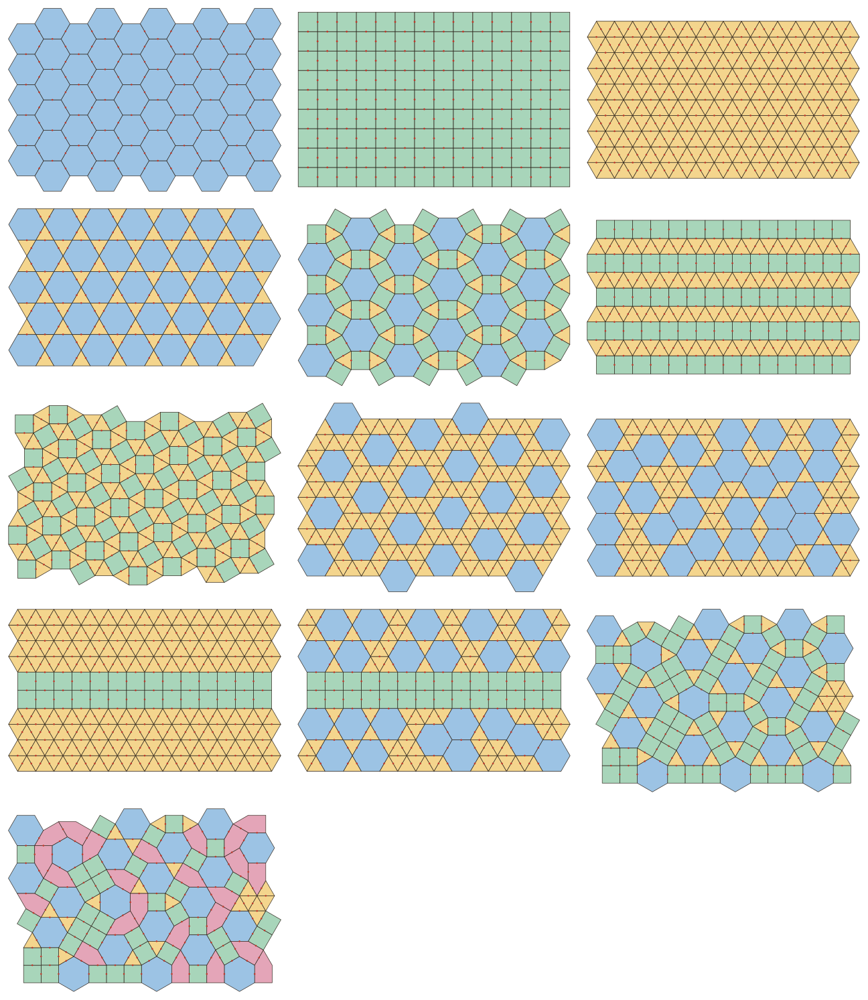
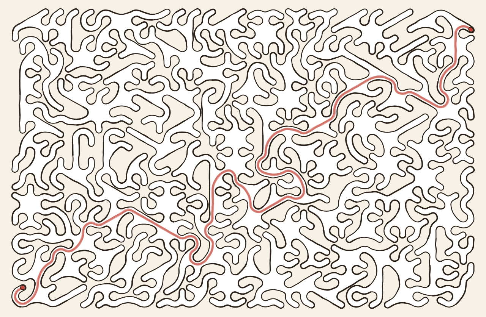

# Tilings

[Back to the README](../README.md)

Every tiling uses only triangles, squares and hexagons whose edges are all the
same length, so a track keeps its width from one shape to the next. Pick one
with `--tiling NAME`; `--tiling list` prints them all.

*`make tilings` draws these into [`docs/tilings/`](tilings/). The red dots are
the ports: the middles of the edges a track may cross.*

| Name | Vertex configuration | Shapes |
| ---- | -------------------- | ------ |
| `hexagonal` (the default) | 6.6.6 | hexagons |
| `square` | 4.4.4.4 | squares |
| `triangular` | 3.3.3.3.3.3 | triangles |
| `trihexagonal` | 3.6.3.6 | hexagons and triangles |
| `rhombitrihexagonal` | 3.4.6.4 | hexagons, squares and triangles |
| `elongated-triangular` | 3.3.3.4.4 | squares and triangles |
| `snub-square` | 3.3.4.3.4 | squares and triangles |
| `snub-hexagonal` | 3.3.3.3.6 | hexagons and triangles |
| `triangle-hexagon` | random | triangles merged into hexagons at random |
| `row-mix` | random | random rows of squares and triangles |
| `row-mix-hexagon` | random | `row-mix`, with triangles merged into hexagons |
| `random` | random | all three, grown tile by tile |

## Random mixes

The first eight repeat a unit cell, so they look orderly. The last four are
different every time:

- `triangle-hexagon` starts from triangles and, in random order, merges the
  six round a corner into one hexagon.
- `row-mix` lays random rows of squares and triangles, and `row-mix-hexagon`
  then merges triangles into hexagons where it can.
- `random` grows the tiling a tile at a time, choosing each shape by
  `--mix T,S,H`, three weights for triangles, squares and hexagons (default
  `1,1,1`). It is a pull rather than an exact ratio: squares and hexagons
  can't meet without triangles between them.

## Shapes

`--shape` cuts the tiling to a `rectangle` (the default), a `hexagon` or a
`circle`, `-W` by `-H` edge lengths, keeping the largest piece and smoothing
its edge.

[PLAN.md](../PLAN.md#2-which-tilings) has the tilings still to come.
